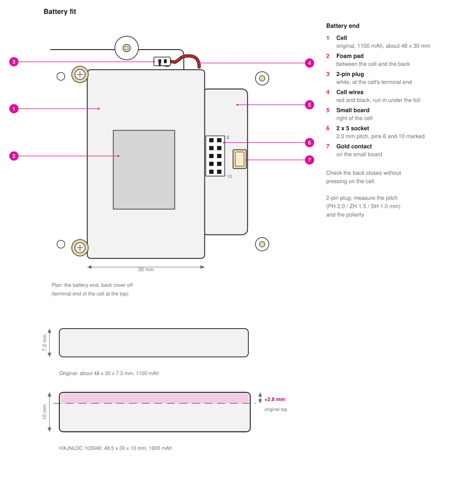

# Replacing the battery

The Pacemaker holds one lithium-polymer cell. This guide fits an HXJNLDC 103048 cell (3.7 V, 1600 mAh) in place of the original.

> A short-circuited, crushed, pierced, overcharged or reversed lithium cell can catch fire. Never use or charge a swollen or deeply flat cell. Work on a non-flammable surface.

## The battery used

| Item | Original cell | Replacement |
|---|---|---|
| Model | PR-723048 (printed on the cell) | HXJNLDC 103048 |
| Voltage | 3.7 V nominal, 4.2 V full | 3.7 V nominal, 4.2 V full |
| Capacity | About 1100 mAh | 1600 mAh (5.92 Wh) |
| Size | 48 x 30 x 7.2 mm | 48.5 x 30 x 10 mm |
| Protection | Built-in | Protection board on the cell |
| Leads | Plug on the original | Red and black leads to a white 2-pin plug |

Any replacement needs built-in protection and a charge rating of at least 1 A, and must be no larger than the space the old cell leaves.

Other cells reported to fit:

| Cell | Size | Notes |
|---|---|---|
| 803448, 1400 mAh | 48 x 34 x 8 mm | Fits more easily |
| 103450, 1800 mAh | 50 x 34 x 10 mm | Very tight |
| 1500 mAh | - | 1 to 2 mm too tall until the old hard-drive retaining brackets were removed |
| 1000 mAh | - | Fits with room to spare |

## Fit and connector

**Thickness.** The new cell is 10 mm thick, about 2.8 mm more than the original 7.2 mm. A row of moulded plastic ribs runs across the inside of the back cover, over the cell: remove them flush with the cover so the back closes without pressing on the cell. The cell must also clear the board connector, the hard-drive locating stays and the two moulded plastic feet.

**Plug.** The original cell plugs into a small white 2-pin socket at the edge of the board, next to the cell, with **+** printed on the board beside it (see the drawing). The HXJNLDC 103048's plug is about twice that size and does not fit.

Move the original plug onto the new cell (it fits the socket and keeps the polarity):

1. Cut the old cell's leads one at a time, as close to the old cell as possible, so the plug keeps the most wire.
2. Cut the new cell's plug off, one wire at a time.
3. Join red to red and black to black, one wire at a time: solder, then cover with heat-shrink before starting the next.

Or splice on a 2-pin pigtail of the socket's series. Kit pigtails are often wired the opposite way round to this board: check against the old plug before connecting. Measure the distance between the centres of the old plug's two pins:

| Pitch | Series |
|---|---|
| 1.0 mm | JST SH |
| 1.25 mm | Molex PicoBlade or JST GH |
| 1.5 mm | JST ZH |

**Polarity.** Red is usually positive and black negative, but generic plugs are sometimes wired the other way round. Check with a multimeter before connecting:

1. Do this with the cell on the bench, before the plug goes near the board. Set the multimeter to DC volts.
2. Touch the red probe to the red lead's metal contact and the black probe to the black lead's. The new cell should read about 3.7 V or a little more, with a plus sign. A minus sign means the red lead is actually negative.
3. Read the + and - marking on the board socket (or photograph the old cell's leads before removing it). The pass condition: the red lead reads positive on the multimeter and lands on the board's + pin. If either fails, the plug is reversed for this board; re-pin it or solder instead.

> Keep the two probe tips apart: bridging the contacts short-circuits the cell.

> Reversed polarity heats a chip next to the main processor within seconds, hot enough to burn a finger. Unplug at once; left connected, it can destroy the chip or the board.

## Replace the battery

Tools: Torx T6 screwdriver, plastic opening tools, multimeter, double-sided foam tape, side cutters, soldering iron, solder and heat-shrink (to move the original plug onto the new cell).

1. Back up the library, then switch the Pacemaker off. Unplug the mains adapter and USB cable. See [Power and charging](pm-power-charging.md).
2. Remove the six Torx T6 screws from the back.
3. Lift the back plate straight up. Photograph every layer. Do not pry at the display, ribbon cables or the ZIF hard-drive cable.
4. Photograph the old cell's plug and leads, and note which socket pin or pad each wire goes to.
5. Disconnect the old cell: pull its plug straight out of the board socket by the housing, not by the wires.
6. Lift the old cell out. It may be held by tape; peel it slowly and do not bend or pierce the pouch.
7. Remove the moulded ribs across the inside of the back cover, over the cell, flush with the cover.
8. Move the original plug (or a matching pigtail) onto the new cell as in Fit and connector, then check the polarity.
9. Dry-fit the new cell in the bay without connecting it. It must lie flat and clear every part listed under Fit and connector.
10. Plug into the board socket, red lead on the side marked +. Feel the chips next to the main processor for the first few seconds: if it warms, unplug at once.
11. Secure the cell with double-sided foam tape under it so it cannot slide. Keep the leads clear of the screw posts and ribbon cables.
12. Close the case: reseat the ZIF ribbon fully, lower the back plate straight down and refit the six screws. If the back bulges or presses on the cell, stop and reopen it.
13. Charge the cell fully for the first time while watching it: connect the adapter and check every few minutes that the cell and case stay cool. Disconnect it if anything warms noticeably, smells or swells.
14. Switch on and open **Settings > About > Status**. Check that the battery percentage reads normally.

## Troubleshooting

- A chip gets hot right after connecting: reversed polarity. Unplug at once and swap the leads.
- Shuts down at start: check polarity first. A too-low battery voltage also forces shutdown.
- If "hard drive needs checking" appears, reseat the ZIF ribbon.
- Does not start with a new cell: run on the mains adapter with no battery fitted.

## Safety

- Never puncture, crush or bend the cell, and do not bend or heat the pouch tab.
- Keep metal tools off both terminals at once. Cut and insulate one lead at a time so the leads never touch.
- Do not use a cell without a protection board, or one that is swollen, damaged or deeply discharged.
- Charge a new cell for the first time under watch, on a non-flammable surface.
- The 103048 is listed for about 1.6 A maximum discharge; do not use it for high-power loads.
