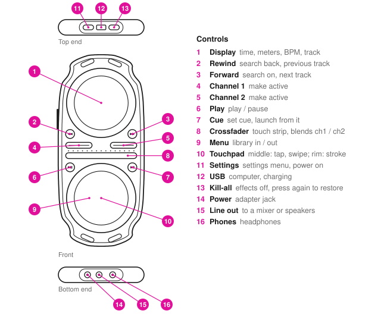
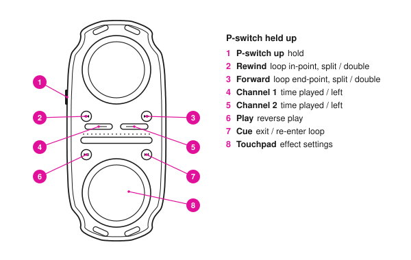
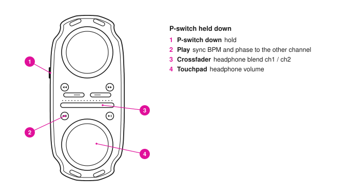
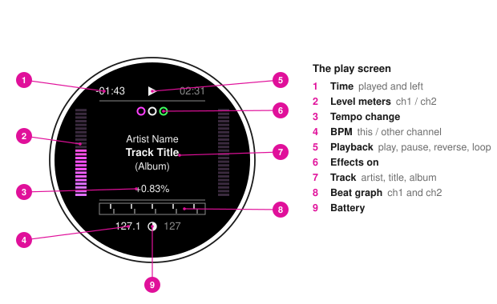

# Controls tour

## Identify the controls

| Number | Control | Does |
|---|---|---|
| 1 | **Display** | Shows time, VU meters, tempo change, BPM, play status, active effects, track info, the beat graph of both channels and power status. See [The play screen](pm-controls-tour.md#the-play-screen) |
| 2 | **Rewind** | Searches backwards in a track or skips to the previous track |
| 3 | **Forward** | Searches forwards in a track or skips to the next track |
| 4 | **Channel 1** | Makes channel 1 the active channel. All other input then acts on it |
| 5 | **Channel 2** | Makes channel 2 the active channel |
| 6 | **Play** | Plays or pauses. Pressing Play on a playing track DJ-pauses it |
| 7 | **Cue** | Sets the cue point or launches from it |
| 8 | **Crossfader** | Touch strip that blends channel 1 and channel 2 to the line output |
| 9 | **Menu** | Enters or leaves the music library |
| 10 | **Touchpad** | Middle: double-taps and swipes. Rim: stroke to change values |
| 11 | **Settings** | Opens the settings menu. Also the power button |
| 12 | **USB connector** | Data and charging |
| 13 | **Kill-all (FX)** | Switches off all EQ and effect changes. Press again to restore |
| 14 | **Power connector** | Jack for the power adapter |
| 15 | **Lineout connector** | Output to a mixer, amplifier or speakers |
| 16 | **Phones connector** | Headphone output |

The **P-switch** (the small switch beside the pad) has two positions besides rest: held up for extended functions, held down for monitoring.

## Control the two channels

1. Press **Channel 1** or **Channel 2**. The channel's information is highlighted on the display.
2. Use any other control. It acts on the active channel only.
3. Press the other channel button to control the other channel.

The crossfader always blends both channels, whichever channel is active. The channel buttons work only while the P-switch is not held.

## Hold the P-switch up for extended functions

| Control | Does with the P-switch up |
|---|---|
| **P-switch** | Enables extended input |
| **Rewind** | Sets or adjusts the loop in point. With **Forward**, splits or doubles a loop |
| **Forward** | Sets or adjusts the loop end point |
| **Channel 1, Channel 2** | Switches the time display of that channel between time played and time left |
| **Play** | Reverse play |
| **Cue** | Exits and re-enters a loop |
| **Touchpad** | Tempo, effects and filters. Swipe from the middle towards a direction, then stroke the rim |

See [Cues, loops and reverse](pm-cues-loops.md), [Mixing and beatmatching](pm-mixing.md) and [Effects, EQ and the Vocal filter](pm-effects.md).

## Hold the P-switch down for monitoring

| Control | Does with the P-switch down |
|---|---|
| **P-switch** | Gives access to the monitoring functions |
| **Play** | Syncs the BPM and phase of the active channel to the other channel in one press |
| **Crossfader** | Blends channel 1 and channel 2 in the headphones |
| **Touchpad** | Rim stroke sets the phones volume |

## The play screen

The screen shows the active channel's information.

| Number | Element | Shows |
|---|---|---|
| 1 | Track time | Time left or time played. Switch with the channel button while the P-switch is up, or set **Track time** in the settings menu |
| 2 | VU meter | Output level of the channel, 24 segments per meter |
| 3 | Track tempo change | Tempo change against the original, in percent |
| 4 | Current track BPM | BPM at the current tempo |
| 5 | Playback status | Symbol at the top centre: play, DJ-pause, search, cue, loop or reverse |
| 6 | Engaged effects | The effects that are switched on |
| 7 | Artist, track title and album | Of the track loaded on the active channel |
| 8 | Beat graph | Tempo and phase of both channels. See [Mixing and beatmatching](pm-mixing.md#match-tempo) |
| 9 | Power status | Battery symbol. Blinks when the battery needs charging. See [Power and charging](pm-power-charging.md) |

## Read the button lights

| Light | Meaning |
|---|---|
| Play and Cue blink | DJ-pause or searching |
| Cue lit | Cue point set |
| Play blinks | Reverse play |
| Cue, Forward and Rewind blink | A loop is running |
| Rewind lit, Forward blinks | Waiting for the loop end point |

## Related articles

- [Power and charging](pm-power-charging.md)
- [Browsing and loading tracks](pm-browsing-loading.md)
- [Mixing and beatmatching](pm-mixing.md)
- [Effects, EQ and the Vocal filter](pm-effects.md)
- [Cues, loops and reverse](pm-cues-loops.md)
- [Recording mixes and making cases](pm-recording.md)
- [The settings menu](pm-settings-menu.md)
- [Connecting to a computer](pm-computer-connection.md)
- [Button combinations and recovery](pm-button-combos-recovery.md)
