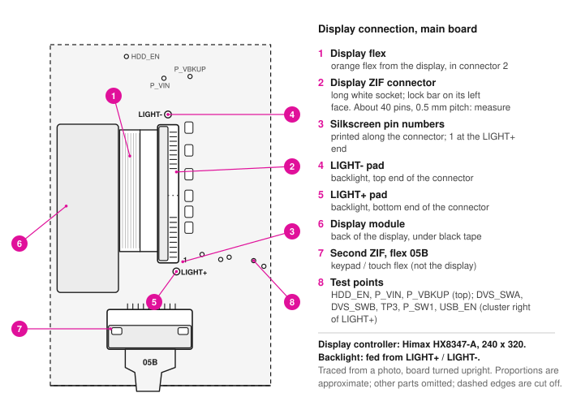

# Swapping the screen

> Status: researched, not yet done on a unit. This is a starting point, not a tested procedure.

## What is known

| Property | Value |
|---|---|
| Controller | Himax HX8347-A (module UMNH8075) |
| Resolution | 240 x 320, 262k colours |
| Interface | 18-bit 8080-style parallel (MPU mode) |
| Logic supply | 3.3 V class |
| Backlight | Driven from the LIGHT+ and LIGHT- pads beside the display connector |
| Connector | Flex in a ZIF on the main board, about 40 pins at 0.5 mm pitch (estimate: measure it) |

The firmware's display driver checks the controller's ID (register 0x67 reads 0x47) and uses Himax-specific registers. Panels with other controllers (ILI9341, ST7789, HX8347-D) will not work with the stock driver.

## Find a matching panel

1. Open the case (six Torx T6 screws, lift the back straight up) and photograph the display flex, both sides.
2. Read any part number printed on the flex or the back of the panel. Search for it first.
3. Count the flex contacts and measure the pitch.
4. Search for an HX8347-A, 240 x 320, 18-bit parallel panel with the same flex width, contact count and pitch.
5. Compare its pinout with the original flex before buying.

## Swap the panel

1. Back up the library and switch off.
2. Release the display ZIF latch and slide the flex out.
3. Fit the new panel, push its flex fully into the ZIF and close the latch.
4. Switch on before closing the case: check the picture, the colours and the backlight.

Full technical notes (driver source, init sequence, timing) are in `notes/lcd-panel.md` in the project repository.
