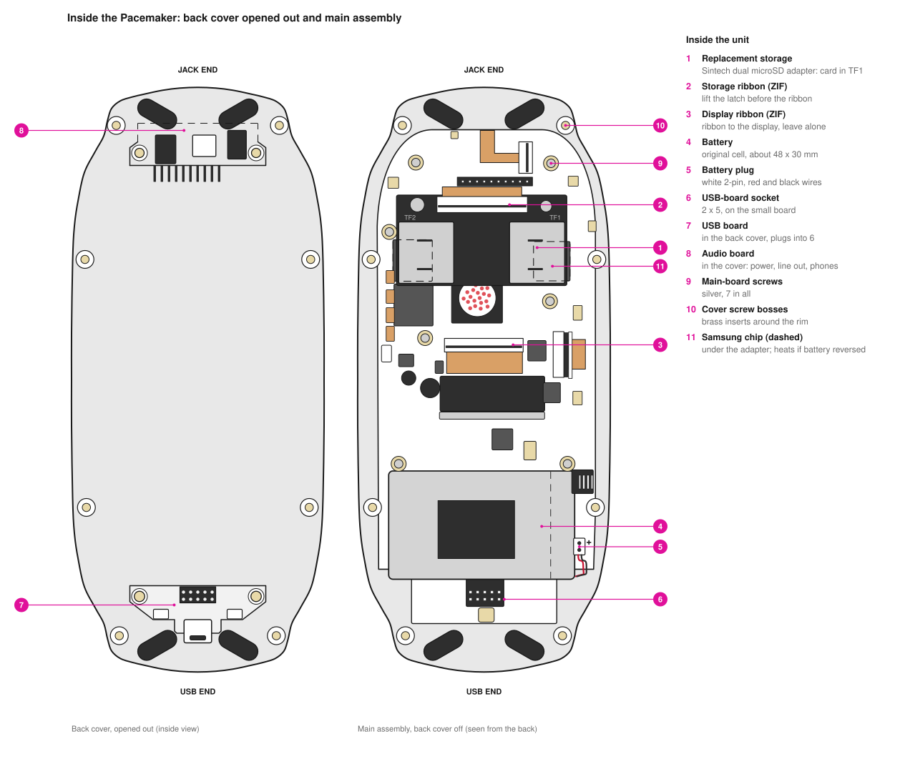

# Upgrading the storage to a microSD card

A microSD card on a 1.8-inch 40-pin ZIF adapter replaces the hard drive. Other options: [Other ways to upgrade the storage](storage-alternatives.md).

> The restore on first power-on erases everything on the new storage. Back up first (step 1).
>
> The unit contains a lithium battery: do not pierce, bend or short it or its leads, and keep metal tools away from the board.

## Tested parts

- Adapter: Sintech microSD TF to 1.8-inch 40-pin ZIF CE, dual-slot, card in slot 1.
- Card: 64 GB UHS Speed Class 3 (U3) microSD.

## Tools

| Tool | Use |
|---|---|
| Torx T6 screwdriver | Six back screws |
| Small flat tool (flat screwdriver or spudger) | ZIF latches |
| ESD wrist strap | Protects the board |
| PC card reader | Checking the card and, if needed, partitioning |

The T6 size for the screws is taken from the [bergq.se guide](storage-upgrade.md#other-guides), written for the P211.

You also need a Revival firmware file (`.pfw`): see [Installing firmware with the app](install-firmware.md).

## What works

| Item | Requirement |
|---|---|
| Card | Genuine, from a known maker and a reputable seller |
| Speed | UHS Speed Class U1 or U3, ideally A1 |
| Size | 32 to 128 GB (maximum usable 128 GiB, about 137 GB) |
| Slots | One card, in slot 1 on a dual-slot adapter |
| Library format | FAT32 |
| Firmware | Revival 180096073 or later shows the full card. Stock firmware shows about 8.46 GB |

## What to avoid

- Fake or no-name cards. Test new cards with H2testw.
- Cards above 128 GiB.
- Two cards on a dual-slot adapter: they join as one disk.
- Pulling on the flat ribbon. A short replacement is hard to find.

## Replacing the drive

1. Charge the Pacemaker fully. On the Device page, run **Backup** and then **Verify a backup** (see [the Device page](device-page.md)); tick **Include the audio files** if the music should be kept. Keep a stock firmware file and a Revival firmware file at hand.
2. Switch the unit off, put on the ESD strap and remove the six screws in the back with the T6. Lift the back half straight up: it has connectors at both ends and must not be hinged or twisted off. Put it aside without pulling on the connectors.
3. Lift out the shock-protection holder that surrounds the drive. Note which way up it sits and how it fits into the small holes in the main board.
4. Free the drive and ribbon, main board latch first. Lift each latch with the flat tool, never by pulling the ribbon.
   - Main board side (first): slide the tool under the black ZIF bar where the ribbon enters the main board and lift it. Draw the ribbon out of the connector together with the drive.
   - Drive side (second): with the drive and ribbon out, lift the latch on the drive's own connector and slide the ribbon out of the drive.
5. Fit the ribbon to the adapter. Push it fully into the adapter's ZIF connector and close the latch: the white line on the ribbon must not be visible.
6. Lay the adapter where the drive was, feed the ribbon end into the main board connector the same way and close the main board latch.
7. Insert the microSD card into slot 1 of the adapter, with the second slot empty. Refit the shock-protection holder over the adapter, the same way up as before, seated in the holes in the main board. Check the ribbon is not trapped under the holder.
8. Fit the back half straight down onto both connectors and refit the six screws.
9. Switch on. On a blank card the unit shows "Sorry friend... hard drive needs checking": press **Continue**, then **Restore** at "Restore hard drive?". Wait for the restart and "Hard drive restored. Please upgrade firmware." If "hard drive needs checking" comes back, reseat the ribbon and card.
10. Install Revival firmware 180096073 or later with the app, following [Installing firmware with the app](install-firmware.md). Docked over USB works: copy the file, eject, then unplug the USB cable before the Pacemaker powers on. The install resets the settings.
11. Open the **Storage** card on the Device page and check it shows most of the card's capacity. If the first partition is far too small, repartition the card on a PC (see the partition layout below). To reach the card, repeat steps 2 and 3, take it out and use the card reader; refit it afterwards as in steps 7 and 8.
12. Copy the library back from the backup with `restore-library.py` ([Ways to install firmware](firmware-methods.md)), then re-apply the settings with the Settings presets card or the script's `--settings-only` option. Open the library in the app and run **Library health**.

## Partition layout

| Partition | Use | Format |
|---|---|---|
| Second (`hda2`) | System | ext3, about 500 MiB |
| First (`hda1`) | Music and library, label `Pacemaker` | FAT32, rest of the card |

Windows cannot make ext3, or FAT32 above 32 GB. Use the Pacemaker's Restore or a Linux machine. When partitioning by hand use an MBR table with two primary partitions as above; the FAT32 partition has type `0C`.

## Fix slow loading

See [Troubleshooting and FAQ](troubleshooting.md) for the optional DMA mode.

## Other guides

- [How to replace/upgrade the HDD in a Tonium Pacemaker (P211) to a SSD](https://wordpress.bergq.se/guide-how-to-replaceupgrade-the-hdd-in-a-pacemaker-to-a-ssd/) (bergq.se, 2016, updated 2022): the same teardown with a 40-pin ZIF PATA SSD, based on an earlier cubicgarden.com guide.

## Related

- [Troubleshooting and FAQ](troubleshooting.md)
- [Button combinations and recovery](pm-button-combos-recovery.md)
