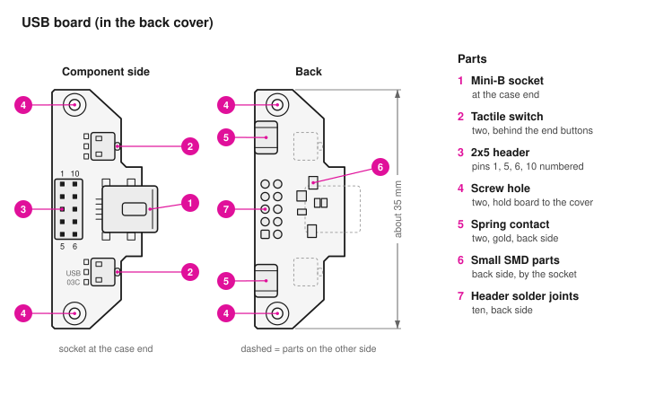
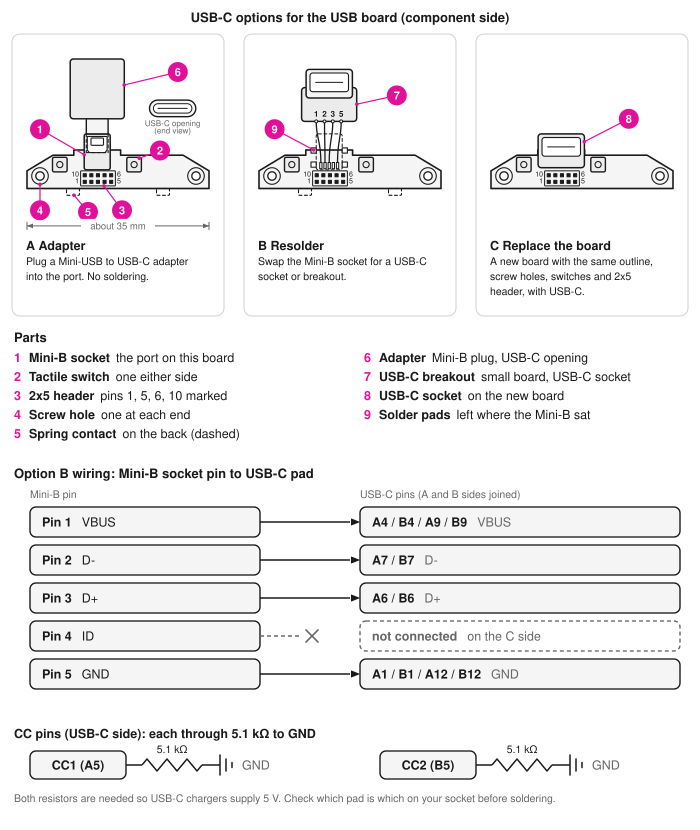

# Replacing the USB port with USB-C

The Mini-B port sits on a small board in the back cover, at the end with the Settings and Kill-all buttons. The board is about 35 mm long, held by two screws, carries the two button switches, and plugs into the main board through a 2 x 5 pin header.

## Choose an option

| Option | Work | Opens the case |
|---|---|---|
| A. Adapter | Plug a Mini-USB to USB-C adapter into the port | No |
| B. Re-solder | Replace the Mini-B socket on the USB board with a USB-C socket or breakout | Yes |
| C. Replace the board | Fit a new board with the same outline, screw holes, switches and header, with USB-C | Yes |

> Status: options B and C are researched, not yet done on a unit.

## A. Adapter

1. Buy a Mini-USB (male) to USB-C (female) adapter that carries data, not a charge-only one.
2. Plug it into the Pacemaker's port and leave it there.
3. Check both uses: charging from a USB-C charger with a C-to-C cable, and the Pacemaker showing up on the computer in the app.

## B. Re-solder the port

Parts: a USB-C breakout with a 16-pin (or larger) receptacle and 5.1 kOhm resistors from CC1 and CC2 to ground. A 6-pin USB-C part is power only and cannot carry USB storage. Tools: Torx T6, fine soldering iron or hot air, flux, solder wick, Kapton tape, multimeter.

| Mini-B pin | Signal | USB-C pins |
|---|---|---|
| 1 | VBUS | A4, A9, B4, B9 |
| 2 | D- | A7, B7 |
| 3 | D+ | A6, B6 |
| 4 | ID | not connected |
| 5 | GND | A1, A12, B1, B12 |
| none | CC1, CC2 | A5 and B5, each through its own 5.1 kOhm to GND |

1. Back up the library, switch off, and open the case (six Torx T6 screws, lift the back straight up).
2. Unscrew the USB board from the back cover and lift it off its header.
3. Tape the switches with Kapton, flux the socket and remove it with hot air or the iron and wick. Do not lift pads.
4. Wire the breakout to the pads as in the table, then glue it down for strain relief.
5. Open up the case slot if the USB-C plug does not reach: the USB-C opening is wider than Mini-B.
6. Before refitting, check with the multimeter: no short between VBUS and GND, D+ and D- not shorted, each CC pin about 5.1 kOhm to GND.
7. Refit the board and the back, then test charging and the computer connection as in option A, step 3.

## C. Replace the board

1. Measure the old board: outline, the two screw holes, the switch positions and the header position.
2. Trace each header pin to the Mini-B pads and the switches with the multimeter, and note the header pin numbers (1, 5, 6 and 10 are marked on the board).
3. Design the new board with those positions, a 16-pin USB-C receptacle, the two 5.1 kOhm CC resistors and the same 2 x 5 header.
4. Fit it in place of the old board and test as in option B, steps 6 and 7.
